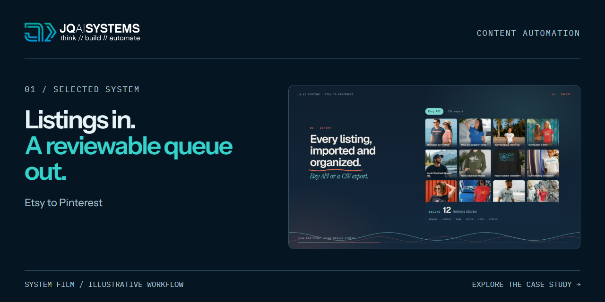
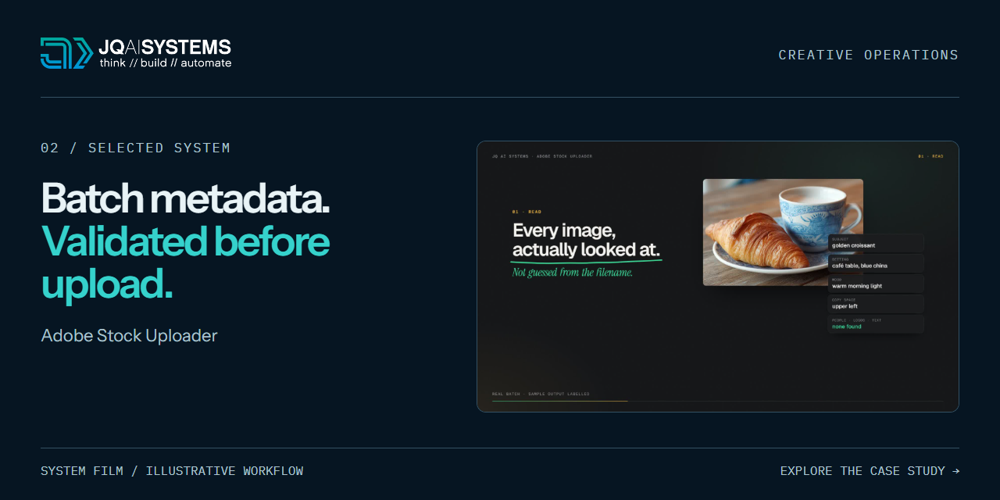

# Selected work / Case studies

Brand-led websites, SEO checkpoints and AI systems by João Queirós. Explore the problem, approach, working examples and what can be adapted.

[Explore the demos](https://github.com/jqaisystems/jqai-public-demos) · [Full systems library](https://www.ai.joaoqueiros.com/systems) · [Discuss a project](https://www.ai.joaoqueiros.com/contact)

These are public breakdowns of internal systems and planning examples. Each page explains its status and boundaries.

## Websites and search

### Scrollwork

Brand design and website development in one practice, with scroll-driven examples of actual work.

[Read the breakdown](case-studies/scrollwork.md) · [Explore the website](https://www.ai.joaoqueiros.com/scrollwork) · [View the interaction preview](assets/showcase/scrollwork-preview.gif)

### Cairn

SEO audits and four-week checkpoints, connecting evidence to a written decision.

[Read the breakdown](case-studies/cairn.md) · [Explore the website](https://www.ai.joaoqueiros.com/cairn) · [View the workflow preview](assets/showcase/cairn-preview.gif)

## Selected systems

### Etsy to Pinterest

Prepare image pins for scheduling and video pins for a controlled manual queue.

[Read the breakdown](case-studies/etsy-to-pinterest-pipeline.md) · [Website case study](https://www.ai.joaoqueiros.com/systems/etsy-to-pinterest) · [Watch the film](https://www.ai.joaoqueiros.com/media/systems/films/etsy-to-pinterest.mp4)

### Adobe Stock Uploader

Visually review assets, prepare ordered metadata, then validate the CSV before submission.

[Read the breakdown](case-studies/adobe-stock-uploader.md) · [Website case study](https://www.ai.joaoqueiros.com/systems/adobe-stock-uploader) · [Watch the film](https://www.ai.joaoqueiros.com/media/systems/films/adobe-stock-uploader.mp4)

### SEO Engine

Run indexing checks, guard sitemaps and make search decisions against dated checkpoints.

[Read the breakdown](case-studies/seo-engine.md) · [Website case study](https://www.ai.joaoqueiros.com/systems/seo-engine) · [Watch the film](https://www.ai.joaoqueiros.com/media/systems/films/seo-engine.mp4)

## All case studies

| Project | Workflow |
|---|---|
| [Scrollwork](case-studies/scrollwork.md) | Brand-led website design and development |
| [Cairn](case-studies/cairn.md) | Search audits and four-week decisions |
| [Etsy to Pinterest](case-studies/etsy-to-pinterest-pipeline.md) | Image-pin scheduling and a separate video-pin queue |
| [Adobe Stock Uploader](case-studies/adobe-stock-uploader.md) | Visual batch review and metadata validation |
| [SEO Engine](case-studies/seo-engine.md) | Indexing, sitemap checks and dated checkpoints |
| [Tidesstunes](case-studies/tidesstunes-social-pipeline.md) | Music videos into vertical clips and queued posts |
| [OutreachIQ](case-studies/outreach-iq.md) | Lead research, scoring, drafting and review |
| [AI News Curator](case-studies/ai-news-curator.md) | Sources into briefings, archives and review queues |
| [AI Brief Generator](case-studies/ai-brief-generator.md) | Intake into a structured creative brief |
| [Content Calendar](case-studies/social-media-content-calendar.md) | A brand brief into a content plan |
| [Client Portal](case-studies/client-portal-automation.md) | Onboarding, updates and handoff |
| [Client Intake](case-studies/client-intake-automation.md) | Planning blueprint for inquiry qualification |

## Planning example

The [Client Intake blueprint](blueprints/client-intake-automation/) contains fictional scenarios, fields, a scoring rubric, response templates and a review-queue specification.

What the public case studies contain

Problems, workflow explanations, review points and publicly documented outcomes. Private source, prompts, credentials, client data, logs and deployment configuration are excluded. Film previews are illustrative explanations, not screenshots of a private live system.

[Discuss a similar system](https://www.ai.joaoqueiros.com/contact) · [JQ AI SYSTEMS](https://www.ai.joaoqueiros.com)
