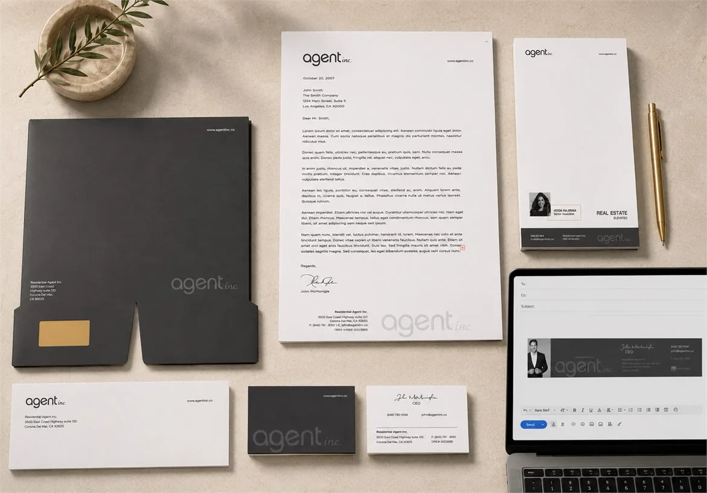

# Agent Inc.: a real estate brand identity

A client branding project by João Queirós, documented in the public portfolio. Reviewed 29 October 2026.

| At a glance | Details |
|---|---|
| Role | Brand identity and graphic design |
| Status | Completed client branding project |
| Evidence | Published identity applications, graphic standards and client reference |

[View the full branding project](https://www.joaoqueiros.com/portfolio-agent-inc-real-estate-branding.html)

## The brief

Agent Inc., a real estate brokerage in Corona Del Mar, California, needed an identity that could work across its office, agent communications and property marketing.

## The approach

The identity centres on a lowercase wordmark and a restrained black-and-white palette. A consistent typographic system connects small formats, such as business cards and email signatures, with property brochures, signage and editorial layouts.

## What I designed

- Logo and visual identity, with graphic standards for consistent use.
- Stationery, business cards and digital signatures.
- Property marketing, signage and event applications.
- Editorial design for the Elevated lifestyle magazine.

## Documented outcome

The public case brings these applications together as one identity system. It includes office and event applications, brochure spreads and a client reference from John McMonigle. These show the scope and consistency of the design work; no sales or conversion result is claimed.

The image above is an existing portfolio presentation of the stationery system. The full portfolio contains the wider project and credits. Client marks and project artwork remain with their respective rights holders and are shown as portfolio evidence, not reusable open-source assets.

[Back to selected work](../README.md) · [Discuss a brand identity](https://www.ai.joaoqueiros.com/contact)
