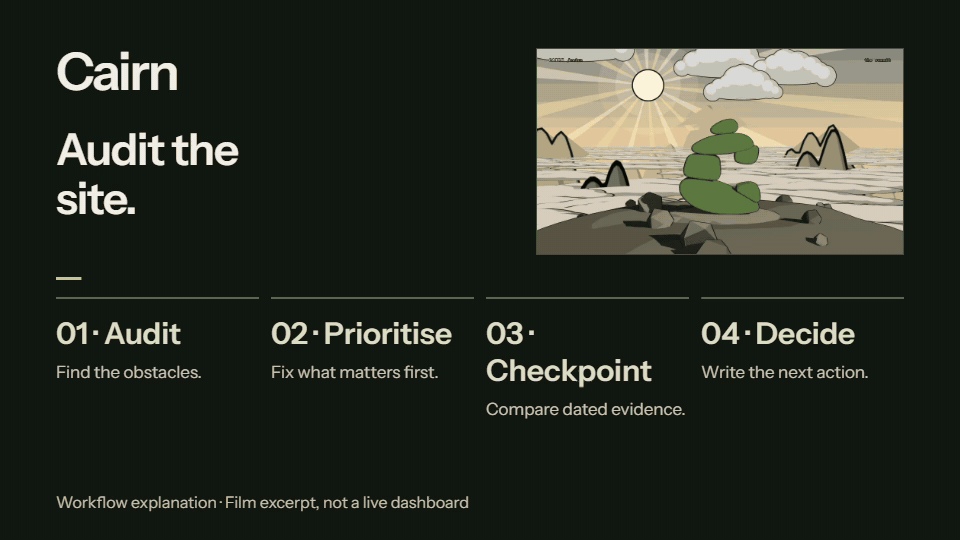

# Cairn: SEO audits and four-week checkpoints

Public service breakdown, based on the published Cairn website. Reviewed 28 October 2026.

[Explore Cairn](https://www.ai.joaoqueiros.com/cairn) · [Watch the film](https://www.ai.joaoqueiros.com/cairn/media/cairn-film.mp4) · [Remix the creative film](https://github.com/jqaisystems/visions-recipes/tree/main/recipes/r24-cairn)

<a href="https://www.ai.joaoqueiros.com/cairn"><picture><source media="(prefers-reduced-motion: reduce)" srcset="../assets/showcase/cairn-preview.png"></picture></a>

[Static preview](../assets/showcase/cairn-preview.png). This is an explanatory composition using the public film, not a live analytics dashboard.

## Problem

Search data is useful when it leads to a decision. Small businesses need to know what blocks visibility, which fixes matter first and what changed after the work.

## What the service does

Cairn combines an SEO audit with recurring four-week checkpoints. It checks source data, indexing and sitemap health, then turns the findings into a written next step.

## Workflow

1. Connect Search Console, GA4 and Bing Webmaster Tools.
2. Inspect sitemap URLs for indexing, crawl and canonical state.
3. Check sitemap destinations after website changes.
4. Notify supported discovery services where appropriate.
5. Compare the next checkpoint with the dated baseline.
6. Write down what changed and decide the next action.

## Outcome

The deliverable is a dated checkpoint and a written decision. The public page shows the method, an example report and dated evidence from João's own website. Those observations describe that site at the stated checkpoint; they do not establish expected results for another business.

The ranking progression used in the site's illustrative scene is explicitly an example, not a ranking promise. Changing figures stay on the [public evidence page](https://www.ai.joaoqueiros.com/cairn#proof), alongside their dates.

## What can be adapted for clients

- A prioritized search audit and repair plan.
- Indexing and sitemap checks for a website.
- A repeatable checkpoint with a stable comparison basis.
- A readable report linking evidence to the next decision.

## Safety boundary

This breakdown uses the published service description. It excludes private analytics exports, search-property access, credentials, client reports and deployment configuration. Film imagery explains the method; it is not proof of a client's results.

[Back to the case studies](../README.md) · [Discuss search visibility](https://www.ai.joaoqueiros.com/contact)
