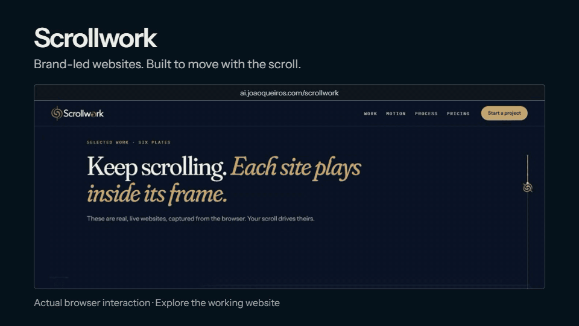

# Scrollwork: brand-led websites

Public portfolio breakdown, based on the published Scrollwork website. Reviewed 28 October 2026.

[Explore Scrollwork](https://www.ai.joaoqueiros.com/scrollwork) · [Watch the film](https://www.ai.joaoqueiros.com/scrollwork/media/scrollwork-film.mp4) · [Remix the creative film](https://github.com/jqaisystems/visions-recipes/tree/main/recipes/r23-scrollwork)

<a href="https://www.ai.joaoqueiros.com/scrollwork"><picture><source media="(prefers-reduced-motion: reduce)" srcset="../assets/showcase/scrollwork-preview.png"></picture></a>

[Static preview](../assets/showcase/scrollwork-preview.png). The GIF records the public website. The separately linked creative film is an interpretation of the service.

## Problem

A brand needs a website whose structure, typography and movement feel like the same identity. A portfolio also needs to show how that work behaves, beyond a collection of still images.

## What the service does

Scrollwork brings brand design and website design/development into one practice. Its public site presents real websites inside scroll-driven frames, alongside the design process and films made in code.

## Workflow

1. Establish the offer, audience and the identity the site must express.
2. Decide the content hierarchy and the visitor's next step.
3. Design the page and its responsive layouts.
4. Build motion around the content and scrolling interaction.
5. Review readability, navigation and the working site before launch.
6. Present the finished work with clear role and credit information.

## Outcome

The public site demonstrates the relationship between brand, page design and interaction. Visitors can explore the finished destinations and understand the role behind each example.

For Four Sparrows Mahjong, João designed the brand identity and base website design. **Beth Varian of Webmaster For Hire developed the WordPress website.** See the [published project credit](https://www.ai.joaoqueiros.com/scrollwork#work) and [development story](https://webmasterforhire.us/website-design-portfolio/mahjong-website-development/).

## What can be adapted for clients

- A website that extends an established brand identity.
- A product or service page with a clear visitor journey.
- Scroll-driven demonstrations of actual work.
- A film or case study that explains the work and credits collaborators.

## Safety boundary

This breakdown uses public portfolio material. It excludes client briefs, private source, credentials, messages and unpublished work. A project shown in the portfolio is not automatically licensed for reuse; use your own work in remixes.

[Back to the case studies](../README.md) · [Discuss a website](https://www.ai.joaoqueiros.com/contact)
